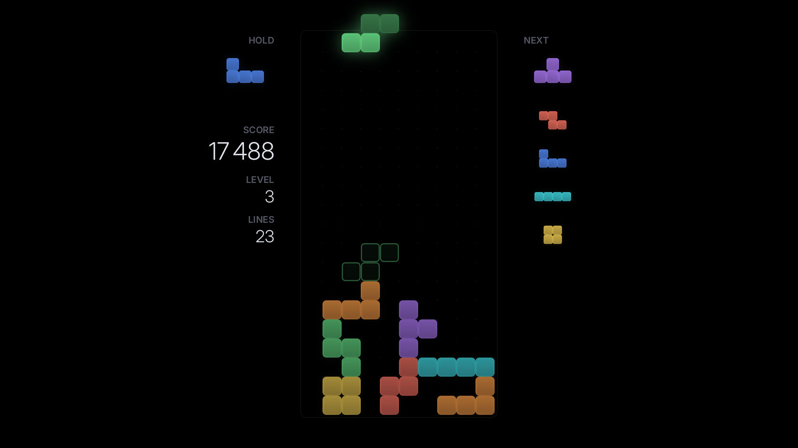
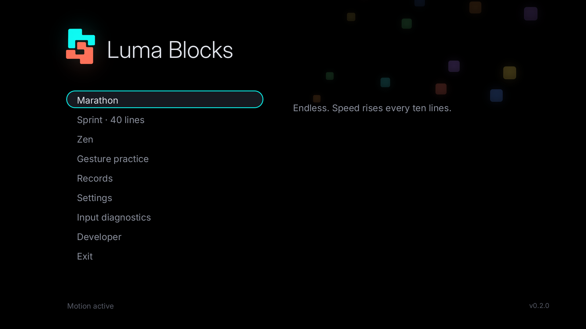
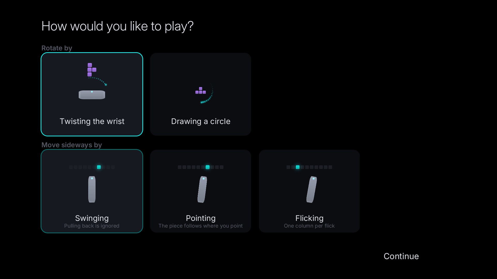
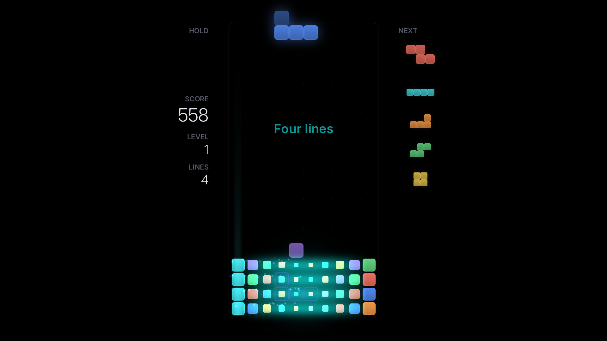
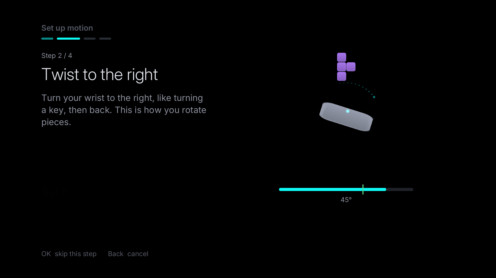
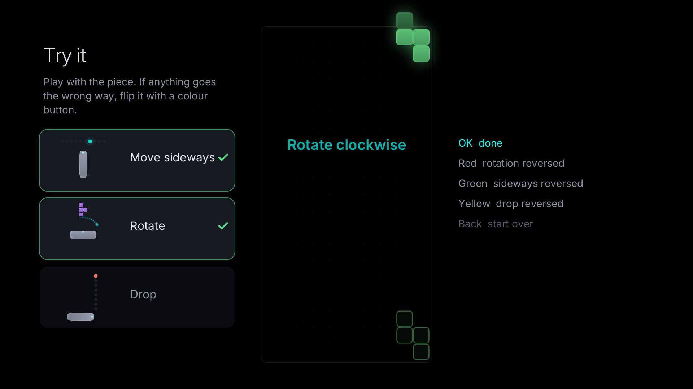

# Luma Blocks

**A minimalist falling-block puzzle for LG webOS TVs, played with the Magic Remote's motion
sensor or with ordinary remote buttons.** Native Rust, SDL2 and OpenGL ES 2, true-black OLED look.


> **Status: test build (pre-release).** The game, the button controls and the gesture engine are
> complete and covered by host tests. The TV package builds, passes ABI checks and starts under
> ARM emulation. **It has not yet been run on a TV**, so the Magic Remote motion stream, the
> button mapping and on-TV performance are unverified. The checks still needed are in
> [docs/TV_CHECKLIST.md](docs/TV_CHECKLIST.md).

| | |
|---|---|
|  |  |
| Marathon on true black: soft halos, dim outlined landing preview | Main menu |
|  |  |
| First-run choice of gesture styles, with animated illustrations | A four-line clear: flash, centre-out dissolve, stack falls into place |
|  |  |
| Motion setup: animated instruction with a live gauge | The try-it board at the end of setup |

Desktop simulator captures; the TV runs the same renderer.

## Features

* **Motion controls**:
  * Rotate with a **wrist twist** or by **drawing a circle**.
  * Move sideways by **swinging** (default): a quick sideways swing moves the piece as far as
    you swing, and the natural pull back is ignored. Alternatives are **pointing** at a column
    or **flicking** one column at a time.
  * **Hard drop** with a quick downward flick.
  * Rotation and sideways styles are independent, so all six combinations work.
  * Sensitivity is adjustable separately for sideways movement, rotation and drop, and gesture drop can be turned off.
  * A guided, animated setup measures the remote's axes from the gyroscope and ends on a live
    try-it board where any reversed direction can be flipped with a colour button.
* **Complete button play**:
  * Left/Right move (adjustable auto-repeat), Down soft drop, Up rotate, OK hard drop, Back pause.
  * Colour buttons are remappable shortcuts: Red rotate anticlockwise, Green hold, Blue recenter.
  * The pause menu offers every action, so a minimal remote can still play.
* **Modes**: Marathon (local high scores), Sprint 40 lines (best times), Zen (gentle, unranked) and Gesture practice (no gravity, no game over).
* **Modern rules**: SRS rotation with wall kicks, seven-bag, hold, five-piece preview, ghost piece, lock delay with bounded resets, T-spins, back-to-back, combos and perfect clears.
* **Always resumable**: the game is saved continuously. Leave mid-game and on the next launch the app asks **Continue / New game**. A restored game comes back paused, with all input cleared.
* **OLED-friendly**:
  * True `#000000` everywhere and no full-screen flashes.
  * Menus dim after you stop using them and fade to black later; play pauses when you are away.
  * Reduced-motion, colour-pattern, glow and volume settings.
* Quiet synthesized sound effects. Offline: no accounts, ads, analytics or network use.

## Install

Download the `.ipk` from [Releases](https://github.com/danzig666/luma-blocks-webos/releases):
`io.github.danzig666.lumablocks_<ver>_arm.ipk` is the normal app. The `.debug_` package is a
separate "Luma Blocks (Dev)" identity with its own saves. Then follow
[docs/INSTALL.md](docs/INSTALL.md) (Developer Mode or rooted/Homebrew Channel).

Controls, calibration and troubleshooting: [docs/CONTROLS.md](docs/CONTROLS.md).

## Build

```sh
cargo test --workspace                 # engine, gestures, persistence (no TV needed)
cargo run -p luma-app                  # desktop simulator
```

TV package: [docs/BUILDING.md](docs/BUILDING.md). GitHub Actions builds, audits, smoke-tests and
packages every push.

## Documentation

| | |
|---|---|
| [ARCHITECTURE](docs/ARCHITECTURE.md) | modules, input pipeline, platform choices, reference research |
| [CONTROLS](docs/CONTROLS.md) | control reference, gesture calibration guide, troubleshooting |
| [BUILDING](docs/BUILDING.md) | pinned toolchain, host support, simulator, packaging |
| [INSTALL](docs/INSTALL.md) | Developer Mode and Homebrew Channel installation, helpers |
| [COMPATIBILITY](docs/COMPATIBILITY.md) | verified / untested matrix |
| [TESTING](docs/TESTING.md) | what the automated tests cover, and their results |
| [TV_CHECKLIST](docs/TV_CHECKLIST.md) | on-TV verification steps and acceptance targets |

## License

MIT (see [LICENSE](LICENSE)). Bundles SDL2 (zlib) and the Inter typeface (SIL OFL 1.1); full
notices ship inside the package. Not affiliated with LG or The Tetris Company.
